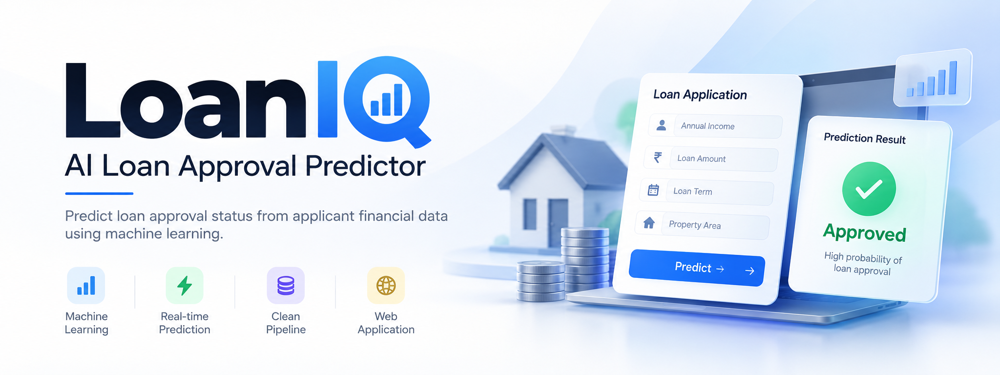

<div align="center">



# LoanIQ — AI Loan Approval Predictor

[](https://python.org)
[](https://flask.palletsprojects.com)
[](https://scikit-learn.org)
[](https://xgboost.readthedocs.io)
[](https://lightgbm.readthedocs.io)
[](https://loan-approval-predictor-8p0v.onrender.com)
[](LICENSE)

An end-to-end machine learning project that predicts loan approval status from applicant financial data. The system includes a preprocessing pipeline, feature engineering, hyperparameter-tuned Random Forest classifier, and a Flask web application for real-time inference.

**Live deployment:** [loan-approval-predictor-8p0v.onrender.com](https://loan-approval-predictor-8p0v.onrender.com)

---

## Table of Contents

- [Live Demo](#live-demo)
- [Architecture](#architecture)
- [Dataset](#dataset)
- [Feature Engineering](#feature-engineering)
- [ML Pipeline](#ml-pipeline)
- [Model Performance](#model-performance)
- [Project Structure](#project-structure)
- [Getting Started](#getting-started)
- [API Reference](#api-reference)

---

## Live Demo

The application is deployed on Render and accessible at:

> **[https://loan-approval-predictor-8p0v.onrender.com](https://loan-approval-predictor-8p0v.onrender.com)**

Note: Render free-tier instances spin down after inactivity. The first request may take 30–60 seconds to cold-start.

---

## Architecture

```
┌─────────────────────────────────────────────────────────────────┐
│                         Browser Client                          │
│         Vanilla JS · Glassmorphism UI · Real-time Calc         │
└─────────────────────────┬───────────────────────────────────────┘
                          │  HTTP / JSON
┌─────────────────────────▼───────────────────────────────────────┐
│                      Flask Application                          │
│                app.py · /predict · /health                      │
└──────────┬──────────────────────────────────────────────────────┘
           │
┌──────────▼──────────────────────────────────────────────────────┐
│                      ML Inference Layer                         │
│                                                                  │
│  Raw Input ──► Feature Engineering ──► Preprocessing Pipeline  │
│                                                                  │
│    TotalIncome       ColumnTransformer     Random Forest        │
│    EMI               SimpleImputer    ──►  (300 trees)     ──►  │
│    Balance_Income    OrdinalEncoder        GridSearchCV         │
│    Log Transforms    StandardScaler        5-fold CV            │
└─────────────────────────────────────────────────────────────────┘
           │
┌──────────▼──────────────────────────────────────────────────────┐
│                      Model Artifacts                            │
│          model/artifacts/model.pkl  ·  pipeline.pkl            │
└─────────────────────────────────────────────────────────────────┘
```

---

## Dataset

- **Source:** [Kaggle Loan Prediction Dataset](https://www.kaggle.com/datasets/ninzaami/loan-predication?resource=download)
- **Target Variable:** `Loan_Status` (`Y` = Approved, `N` = Rejected)
- **Sample Distribution:** ~69% Approved, ~31% Rejected

### Input Features

| Attribute | Type | Values / Units | Description |
|---|---|---|---|
| `Gender` | Categorical | Male, Female | Applicant gender |
| `Married` | Categorical | Yes, No | Marital status |
| `Dependents` | Categorical / Discrete | 0, 1, 2, 3+ | Number of financial dependents |
| `Education` | Categorical | Graduate, Not Graduate | Applicant education level |
| `Self_Employed` | Categorical | Yes, No | Employment categorization |
| `ApplicantIncome` | Numeric | Currency units | Applicant monthly gross income |
| `CoapplicantIncome` | Numeric | Currency units | Co-applicant monthly gross income |
| `LoanAmount` | Numeric | Thousands | Requested principal amount |
| `Loan_Amount_Term` | Numeric | Months (e.g., 360, 180) | Amortization period |
| `Credit_History` | Binary | 1 (Good), 0 (Poor) | Credit bureau guideline compliance |
| `Property_Area` | Categorical | Urban, Semiurban, Rural | Collateral property location |

---

## Feature Engineering

Loan decisions depend strongly on debt-service capacity rather than raw income alone. The pipeline derives ten structured indicators:

| Derived Feature | Formulation | Financial Rationale |
|---|---|---|
| `TotalIncome` | `ApplicantIncome + CoapplicantIncome` | Combined household repayment pool |
| `Log_TotalIncome` | `log(TotalIncome + 1)` | Mitigates right-skewness and extreme income outliers |
| `Log_LoanAmount` | `log(LoanAmount + 1)` | Stabilizes variance across loan sizes |
| `EMI` | `LoanAmount / Loan_Amount_Term` | Baseline monthly obligation rate |
| `Balance_Income` | `TotalIncome - (EMI * 1000)` | Residual disposable income post-debt service |
| `DTI_Ratio` | `(EMI * 1000) / (TotalIncome + 1)` | Debt-to-Income ratio; primary indicator of leverage |
| `Loan_Income_Ratio` | `LoanAmount / (TotalIncome + 1)` | Loan-to-income multiplier |
| `Credit_x_Income` | `Credit_History * Log_TotalIncome` | Interaction term prioritizing high-income applicants with clean credit |
| `Income_Per_Dep` | `TotalIncome / (Dependents + 1)` | Household per-capita disposable income |
| `Is_Affordable` | `1 if Balance_Income > 0 else 0` | Binary solvency filter |

---

## Project Structure

```
Loan Approval Predictor/
├── assets/
│   ├── banner.png              # Repository banner graphic
│   └── workflow.png            # End-to-end architecture flowchart
├── model/
│   ├── train.py                # Pipeline script: Feature engineering, SMOTE, Optuna, Stacking
│   ├── loan_model.pkl          # Serialized calibrated ensemble model
│   ├── preprocessor.pkl        # Serialized ColumnTransformer preprocessing pipeline
│   ├── model_metadata.pkl      # Training metrics, hyperparameters, and feature lists
│   └── feature_importance.png  # Generated feature contribution plot
├── templates/
│   └── index.html              # Frontend user interface
├── static/
│   ├── style.css               # Glassmorphic design system and styling
│   └── script.js               # Reactive validation, EMI calculations, API consumer
├── app.py                      # Flask application and REST API endpoints
├── train.xls                   # Dataset (Kaggle loan prediction tabular data)
├── requirements.txt            # Environment specifications
├── Procfile                    # Production entrypoint for cloud deployment (Gunicorn)
└── LICENSE                     # MIT License
```

---

## Installation & Local Setup

### 1. Prerequisites

- Python 3.8 to 3.11
- pip

### 2. Clone and Install Dependencies

```bash
git clone https://github.com/how-vaibhav/Loan-Approval-Predictor.git
cd Loan-Approval-Predictor

pip install -r requirements.txt
```

### 3. Model Training (Optional)

Pre-trained model artifacts are included in `model/`. To retrain the stacking ensemble and rerun Optuna optimization:

```bash
python model/train.py
```

### 4. Run Application

```bash
python app.py
```

The server starts locally on `http://localhost:5000`.

---

## API Documentation

### Health Check

```http
GET /health
```

#### Response (`200 OK`)

```json
{
  "status": "ok",
  "model_accuracy": 0.813,
  "model_version": "v2-stacking-ensemble"
}
```

---

### Loan Approval Prediction

```http
POST /predict
Content-Type: application/json
```

#### Request Payload

```json
{
  "Gender": "Male",
  "Married": "Yes",
  "Dependents": "0",
  "Education": "Graduate",
  "Self_Employed": "No",
  "Property_Area": "Semiurban",
  "ApplicantIncome": 5849,
  "CoapplicantIncome": 0,
  "LoanAmount": 120,
  "Loan_Amount_Term": 360,
  "Credit_History": 1
}
```

#### Response Payload (`200 OK`)

```json
{
  "status": "Approved",
  "approved": true,
  "probability": 84.15,
  "details": {
    "total_income": 5849.0,
    "emi": 0.33,
    "balance_income": 5515.67,
    "log_income": 8.6742,
    "dti_ratio": 0.057,
    "loan_income_ratio": 0.0205,
    "is_affordable": true
  }
}
```

---

## Deployment

The application is deployed on Render using Gunicorn as the WSGI HTTP server:

```
web: gunicorn app:app --log-file -
```

Live service: [https://loan-approval-predictor-8p0v.onrender.com](https://loan-approval-predictor-8p0v.onrender.com)

---

## License

This project is licensed under the [MIT License](LICENSE).
